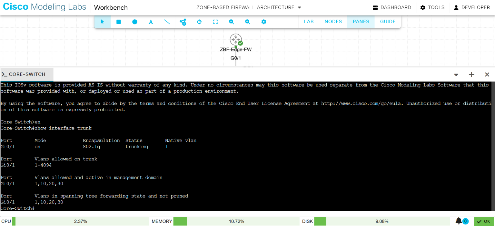
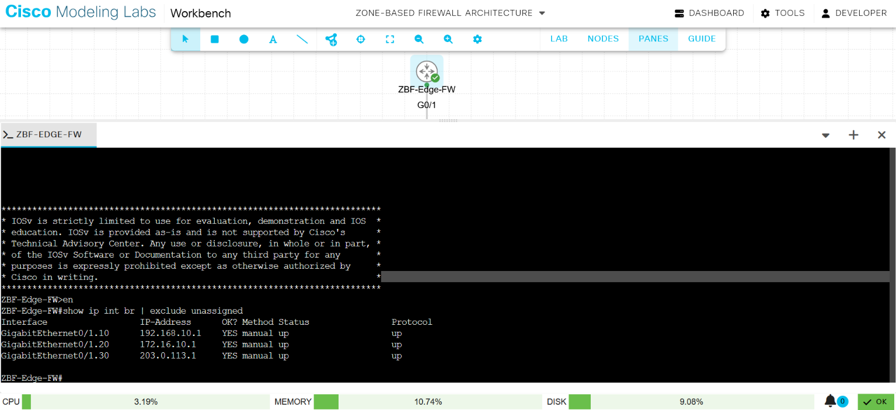
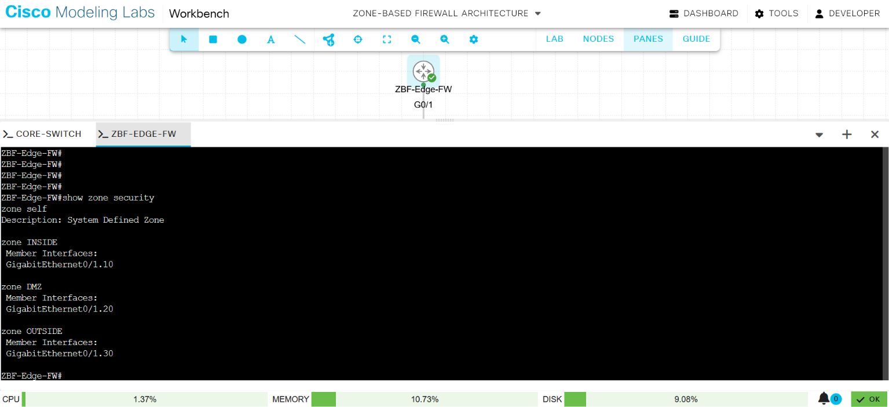
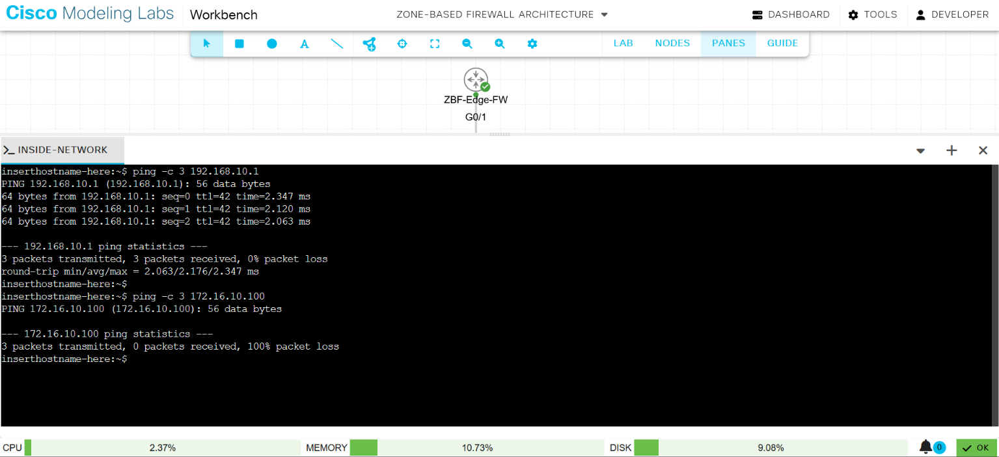
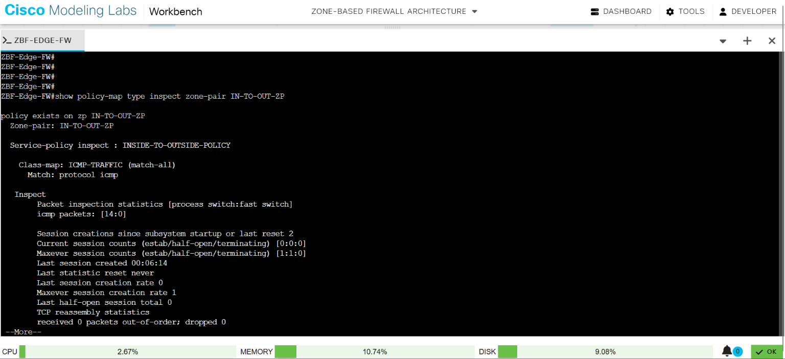

# Technical Lab Documentation: Implementing a Router-on-a-Stick Zone-Based Firewall (ZBF) Topology

## 1. Project Overview & Production Value
In modern enterprise network architectures, traditional stateless Access Control Lists (ACLs) are insufficient for defending critical assets. This project implements a **Cisco Zone-Based Firewall (ZBF)** utilizing a **Router-on-a-Stick (RoaS)** logical framework inside a virtualised sandboxed infrastructure. 

### Why Engineers Deploy This Architecture:
* **Capital Expenditure (CapEx) Reduction:** Rather than consuming multiple high-throughput physical router interfaces for network isolation, a single physical interface is multiplexed across an 802.1Q trunk link to segment traffic.
* **Stateful Security Architecture:** Unlike traditional packet-filtering firewalls that check packets individually, this ZBF deployment utilises **Stateful Packet Inspection (SPI)**. The engine dynamically tracks protocol session states (TCP handshake flags, sequence numbers, and port pairs), automatically opening temporary return paths for legitimate outbound flows while maintaining a default-deny exterior posture.
* **Zero-Trust Zone Segmentation:** Interfaces are assigned to explicit security buckets rather than relying on loose subnet-based filtering. All cross-zone traffic is dropped implicitly unless authorized by a directional zone-pair policy map.

---

## 2. Network Topology & Structural Blueprints
The infrastructure isolates three foundational enterprise network segments:
1. **INSIDE Zone (Trusted):** Internal workforce client subnet. Authorized for outbound stateful diagnostics (ICMP) to the public internet while remaining completely hidden from unsolicited inbound external probes.
2. **DMZ Zone (Semi-Trusted / Demilitarized):** Isolated segment hosting public-facing business assets. Access is strictly constrained to standard web server entry points (HTTP/HTTPS). If a server in this zone is compromised, the firewall architecture prevents lateral movement into internal corporate networks.
3. **OUTSIDE Zone (Untrusted):** Simulates the public internet infrastructure, hosting external actors and untrusted web traffic sources.

```text
                  [ ZBF-Edge-FW ] (vIOS-Router)
                        │
                        │ (802.1Q Trunk Link: Carrying VLANs 10, 20, 30)
                        │
                  [ Core-Switch ] (vIOS-L2 Switch)
                        │
         ┌──────────────┼──────────────┐
         │ (VLAN 10)    │ (VLAN 20)    │ (VLAN 30)
         │              │              │
[ Inside-Network ] [ DMZ-Server ] [ External-Attacker ]
```

---

## 3. Core Infrastructure Configuration

### A. Managed Switch Layer-2 Segmentation (`Core-Switch`)
Configures the VLAN broadcast domains, assigns edge access ports, and establishes the 802.1Q trunk uplink to the firewall router.

```ios
vlan 10
 name INSIDE_VLAN
vlan 20
 name DMZ_VLAN
vlan 30
 name OUTSIDE_VLAN
exit

interface GigabitEthernet0/0
 description Uplink_to_ZBF_Router
 switchport trunk encapsulation dot1q
 switchport mode trunk
 no shutdown
exit

interface GigabitEthernet0/1
 description Inside_Workstation
 switchport mode access
 switchport access vlan 10
 no shutdown
exit

interface GigabitEthernet0/2
 description DMZ_Web_Server
 switchport mode access
 switchport access vlan 20
 no shutdown
exit

interface GigabitEthernet0/3
 description External_Attacker
 switchport mode access
 switchport access vlan 30
 no shutdown
end
```

### B. Router-on-a-Stick & Zone-Based Firewall (`ZBF-Edge-FW`)
Configures the Layer-3 sub-interface gateways, establishes security zones, classifies traffic, and binds stateful inspection policies to directional zone-pairs.

```ios
! 1. Create Security Zones
zone security INSIDE
zone security DMZ
zone security OUTSIDE
exit

! 2. Configure Sub-interfaces & Assign Zone Membership
interface GigabitEthernet0/1
 no shutdown
exit

interface GigabitEthernet0/1.10
 encapsulation dot1Q 10
 ip address 192.168.10.1 255.255.255.0
 zone-member security INSIDE
exit

interface GigabitEthernet0/1.20
 encapsulation dot1Q 20
 ip address 192.168.20.1 255.255.255.0
 zone-member security DMZ
exit

interface GigabitEthernet0/1.30
 encapsulation dot1Q 30
 ip address 203.0.113.1 255.255.255.0
 zone-member security OUTSIDE
exit

! 3. Define Traffic Classification Buckets (Class Maps)
class-map type inspect match-any WEB-TRAFFIC
 match protocol http
 match protocol https
class-map type inspect match-all ICMP-TRAFFIC
 match protocol icmp
exit

! 4. Define Security Actions (Policy Maps)
policy-map type inspect OUTSIDE-TO-DMZ-POLICY
 class type inspect WEB-TRAFFIC
  inspect
 exit
exit

policy-map type inspect INSIDE-TO-OUTSIDE-POLICY
 class type inspect ICMP-TRAFFIC
  inspect
 exit
exit

! 5. Bind Policies to Directional Zone-Pairs
zone-pair security IN-TO-OUT-ZP source INSIDE destination OUTSIDE
 service-policy type inspect INSIDE-TO-OUTSIDE-POLICY
exit

zone-pair security OUT-TO-DMZ-ZP source OUTSIDE destination DMZ
 service-policy type inspect OUTSIDE-TO-DMZ-POLICY
end
```

---

## 4. Engineering Verification & Evidence Portfolio
### Visual Topology & Physical Link Architecture


* **Topology Breakdown:** This Cisco Modeling Labs (CML) canvas illustrates the active Router-on-a-Stick infrastructure. The central routing engine (`ZBF-Edge-FW`) connects via a single 802.1Q trunk link (`GigabitEthernet0/1`) to the managed layer-2 switch (`Core-Switch`). From there, traffic is isolated across three distinct VLAN access ports (`Gi1/0`, `Gi1/1`, and `Gi1/2`) leading directly to the isolated Alpine Linux endpoint nodes representing the **Inside**, **DMZ**, and **Outside** security zones.


### Step 1: 802.1Q Trunk Link Verification
Running `show interface trunk` confirms the managed switch is actively multiplexing, tag-encapsulating, and passing logical traffic boundaries up the single physical wire to the routing core.



### Step 2: Router Routing Interface Validation
Executing `show ip interface brief | exclude unassigned` maps the layer-3 default gateway matrix and confirms all sub-interfaces are up/up.



### Step 3: Firewall Zone Boundaries Verification
The command `show zone security` captures the precise moment the sub-interfaces are isolated into their respective security buckets, immediately initiating a default-drop traffic behavior between domains.



### Step 4: Baseline Traffic Disruption Verification
Initiating connectivity checks from `Inside-Network` to its local default gateway succeeds flawlessly (0% packet loss), while cross-zone communication to the unmapped DMZ server is successfully filtered and dropped (100% packet loss).



### Step 5: Stateful Outbound Traffic Inspection Verification
Running a verification check on `IN-TO-OUT-ZP` demonstrates that outbound ICMP diagnostics are allowed, with packet inspection statistics dynamically tracking session milestones.



### Step 6: Inbound Application Layer Session Match Verification
While the `WEB-TRAFFIC` policy permits both HTTP and HTTPS, inbound application constraints were validated using plain-text HTTP on Port 80. A socket listener was initialized on the `DMZ-Server` via Netcat (`nc -l -p 80`), and an HTTP payload transmitted from the untrusted `External-Attacker` host successfully negotiated the firewall perimeter. Running `show policy-map type inspect zone-pair OUT-TO-DMZ-ZP` verifies the active session tracking state and confirms application-layer hit increments.

> 🎥 **Live Lab Demonstration:** [Watch the real-time Netcat handshake and policy counter verification on YouTube](https://youtu.be/oMhpA5N_VCE)


---

## 5. Technical Keyword Glossary
* **802.1Q (`dot1q`):** An IEEE standard networking protocol that injects a 4-byte identification tag into an Ethernet frame header, allowing a single data link to securely carry traffic for multiple distinct virtual local area networks (VLANs).
* **Sub-interface:** A virtual interface created by splitting a single physical port into multiple logical channels, enabling it to operate as a separate default gateway router interface for independent subnets.
* **Stateful Packet Inspection (`inspect`):** An advanced firewall operation that keeps track of the connection state table (TCP sequence tracking, port mapping, and session lifecycles), automatically authorizing return traffic generated from internal sources while explicitly blocking unsolicited external inputs.
* **Zone-Pair:** A directional configuration mapping a source zone container directly to a destination zone container, serving as the definitive logical anchor point where service policies are bound.

---

## 6. Project Summary & Interview Pitch

## 7. Targeted Security Interview Questions & Technical Responses

### Q1. What is the difference between a traditional ACL and a Zone-Based Firewall?
**Response:** A traditional Access Control List is **stateless**. It looks at packets one by one in isolation. If you allow traffic out, you have to write another manual rule to allow the return traffic back in, which opens up security holes. A Zone-Based Firewall uses **Stateful Packet Inspection**. It tracks the actual state of the connection (like TCP sequence numbers and port pairs). When a trusted internal device initiates a connection, the firewall automatically remembers it and opens a temporary, safe return path for only that specific traffic, blocking everything else.

### Q2. Why did you use a Router-on-a-Stick design instead of giving every zone its own physical router interface?
**Response:** In a production enterprise environment, high-throughput physical router ports are incredibly expensive. Using a **Router-on-a-Stick** design allows us to scale efficiently. By connecting a single physical router port to a managed switch using an **802.1Q Trunk Link**, we can multiplex traffic across multiple isolated broadcast domains (**VLANs**) over one wire. On the router, we break that physical interface into logical **Sub-interfaces**. This achieves the exact same security segregation at a fraction of the hardware cost.

### Q3. If a hacker successfully compromises the Web Server in your DMZ zone, what stops them from attacking your internal corporate office?
**Response:** That is the exact reason I implemented a zero-trust **DMZ security zone**. By default, a Zone-Based Firewall drops all traffic traveling between different zones unless an explicit policy allows it. Our policy map only allows traffic to flow *from* the Outside *to* the DMZ on HTTP Port 80. There is no policy that allows traffic to initiate *from* the DMZ into the Inside zone. Because the firewall blocks all unsolicited inbound traffic across that zone boundary, the hacker remains entirely trapped inside the isolated DMZ segment, protecting our corporate infrastructure.

### Q4. Walk me through the structural steps required to configure a Zone-Based Firewall rule in Cisco IOS.
